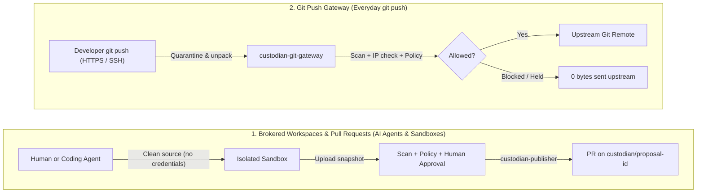

# Custodian

[](https://github.com/timReynolds/custodian/actions/workflows/ci.yml)
[](https://github.com/timReynolds/custodian/actions/workflows/security.yml)
[](LICENSE)

**Custodian** is a self-hosted Git security broker written in Go. It lets developers and AI coding agents work on your repositories without ever giving workspaces GitHub tokens or SSH keys, while checking every change and `git push` for secrets, prohibited licenses, security flaws, and proprietary code leaks before anything leaves your environment.

## Why Use Custodian?

Giving an AI coding agent, contractor sandbox, or automated environment direct Git credentials makes it easy for secrets or proprietary code to leak—and hard to prove who actually wrote or approved a change. Custodian puts a policy-enforced checkpoint between workspaces and your Git remotes:

- **No credentials in workspaces or agent sandboxes** — Workspaces receive clean source snapshots without GitHub tokens, SSH keys, or credential helpers.
- **Stop leaks before code leaves** — Every proposed change and `git push` is scanned for hardcoded secrets, restricted software licenses, security issues, obfuscated payloads, and proprietary code fingerprints before it reaches GitHub or another remote.
- **Real human accountability** — Every workspace and pull request is tied to a verified human owner from your identity provider (never self-asserted by an agent), and published commits record both human authorship and agent assistance via Git trailers.
- **Tamper-proof approvals** — Reviewers approve the exact SHA-256 content digest that was inspected. If anything changes after review, publication is blocked.
- **Strict credential isolation** — The service that holds GitHub write credentials (`custodian-publisher`) is a separate, hardened binary that cannot run scanners, AI models, or untrusted code.
- **Complete audit trail** — Every workspace, scan, policy decision, approval, push, and PR is recorded in a tamper-evident, hash-chained audit log.

## Two Ways to Use Custodian

Custodian supports two complementary workflows—use either one on its own or run both together:



1. **Brokered Workspaces & Pull Requests** — Built for AI coding agents and isolated dev environments. Custodian checks out a clean copy of the repo, hands it to the workspace without credentials, reconstructs submitted changes into a clean diff, runs scanners and policies, collects digest-bound human approval, and opens a single pull request on `custodian/<proposal-id>`.
2. **Git Push Gateway** — Built for everyday `git push` over HTTPS or SSH. Custodian sits in front of GitHub or another Git remote, unpacks incoming pushes in a strict quarantine sandbox, runs secret/license/IP checks, and only forwards permitted pushes upstream. You can roll it out safely in `PASSIVE_AUDIT` mode first before switching repositories to `ENFORCE_BLOCK`.

## How Inspection & Policies Work

Every proposal and push passes through a three-stage pipeline:

1. **Automated Scanners** — Runs Gitleaks (secrets), ScanCode (licenses), Semgrep (SAST), and Trivy (dependency vulnerabilities), alongside built-in proprietary IP fingerprinting and obfuscation/concealment detection.
2. **Optional AI Risk Review** — Sends a server-built, redacted summary to your configured model gateway for nuanced security or IP provenance review. The model can flag or block risky changes, but can **never** override a mandatory security, secret, or IP block.
3. **CEL Policy Rules** — Human-readable YAML bundles written with Common Expression Language (CEL). Organization policies set a mandatory baseline that repository policies can tighten but never weaken, and all policies fail closed on errors.

## Quick Start (Try It Locally)

You can build Custodian and experiment with its policy engine completely offline using just **Go 1.25+** and **Git**:

```sh
# Build all 6 binaries into ./bin/
make build

# Validate the default organization policy bundle
./bin/custodian-policy validate --bundle policies/defaults/default.yaml

# Run the included policy test suites
./bin/custodian-policy test policies/tests

# Run fast unit tests
make test-unit
```

To run the full server stack with PostgreSQL, OIDC authentication, and GitHub Apps, follow [Getting Started & Configuration](docs/getting-started.md).

## Components

| Binary | Purpose |
| :--- | :--- |
| `custodian` | CLI for managing workspaces, proposals, approvals, push status, and Git HTTPS credentials |
| `custodian-api` | REST API server (`/v1`, OpenAPI 3.1) for workspaces, proposals, policies, pushes, IP corpora, and audit logs |
| `custodian-worker` | Background worker that prepares clean checkouts, reconstructs diffs, runs scanners, calls the optional review model, and evaluates policies |
| `custodian-publisher` | Isolated PR publisher holding GitHub write credentials that pushes `custodian/<proposal-id>` branches and opens pull requests |
| `custodian-git-gateway` | HTTPS and SSH Git push proxy that quarantines, scans, and enforces policies before forwarding pushes upstream |
| `custodian-policy` | Standalone CLI to validate, simulate, and unit-test YAML/CEL policy bundles offline |

## Documentation

- [Getting Started & Configuration](docs/getting-started.md) — Prerequisites, building, environment variables, and running the services
- [Workspace & Pull Request Workflow](docs/usage.md) — Step-by-step CLI walkthrough from workspace creation to PR publication
- [Git Push Gateway](docs/push-gateway.md) — Proxying `git push` over HTTPS/SSH, safe rollout modes, approvals, and IP fingerprinting
- [Writing & Testing Policies](docs/policies.md) — Authoring YAML/CEL rules, stages, precedence, and testing with `custodian-policy`
- [Architecture & Security Model](docs/architecture.md) — Security boundaries, credential isolation, digest binding, and repository layout
- [OpenAPI 3.1 Specification](api/openapi.yaml) — Full REST API contract
- [End-to-End Testing](test/e2e/README.md) — Running the offline Docker-backed integration and E2E test suites

## Contributing, Security & License

- Contributions are welcome! See [CONTRIBUTING.md](CONTRIBUTING.md) for development commands and architecture checks.
- Please report security vulnerabilities privately via [SECURITY.md](SECURITY.md).
- Licensed under the [Apache License 2.0](LICENSE).
